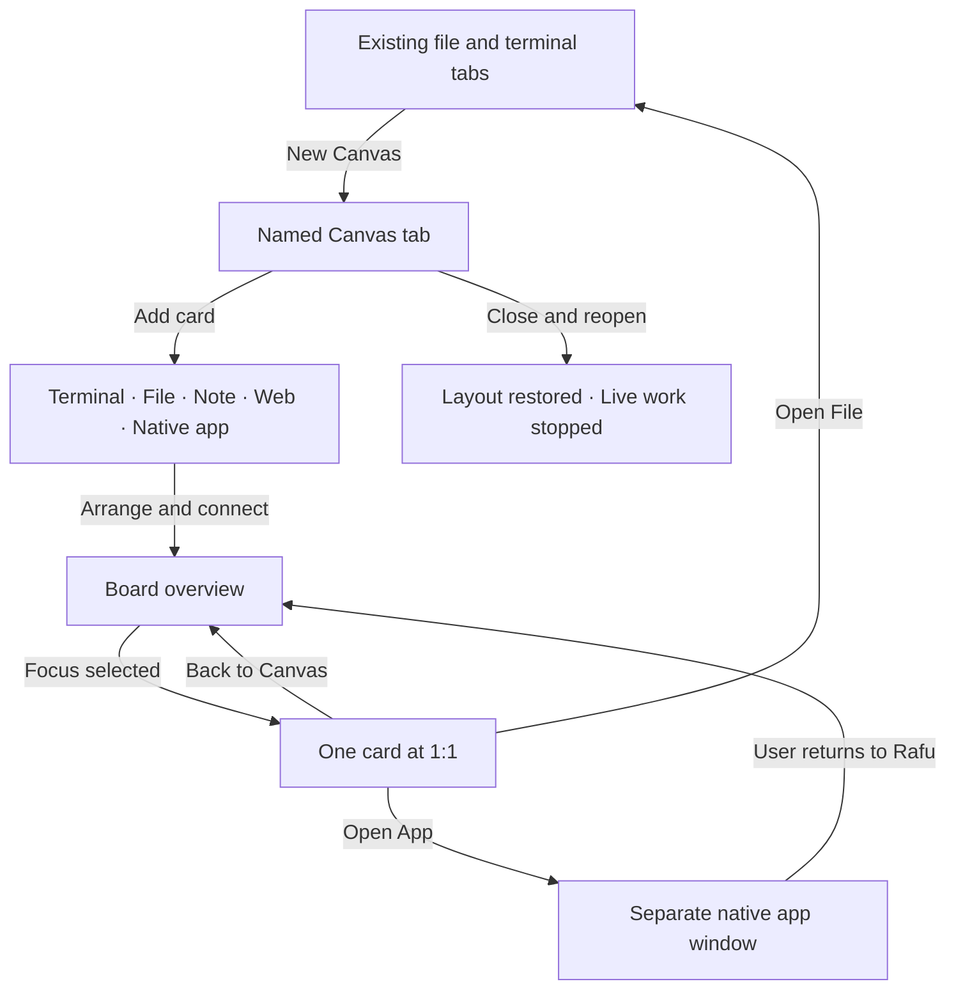
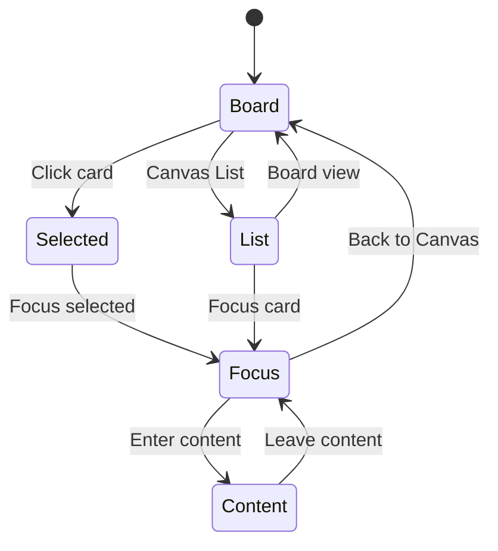

# Rafu Canvas: keep the task in view

A proposed workspace for terminals, files, notes, local web apps, and native macOS app previews. This is a design review. Approval accepts the design direction; it does not start implementation.

<Callout type="tip">
Open the [clickable wireframe](http://127.0.0.1:8756/prototype.html) to try all eight steps. The local server must be running. The `prototype.html` file also works on its own. All terminal, web, and app content is a sample.
</Callout>

<Phase title="Enter from the editor" status="planned">
Keep the current file and Terminal Group. Add Canvas as a named peer tab. Keep the Files Navigator and sidebar toggle available.

<Svg src="./overview.svg" title="Rafu Canvas with five card types" caption="The file shelf stays visible. Each card has a clear type, state, and next action." />

| Action | Result |
|---|---|
| File menu → New Canvas | Create a named board in this window |
| Add Card | Choose a resource; do not start live work |
| Select card | Select its frame, with no input sent to content |
| Drag header | Move that card only |
| Arrange | Align cards; keep their sessions and contents |
| Connect | Add a labeled relationship; execute nothing |

</Phase>

<Phase title="Move between overview and focused work" status="planned">
At overview scale, show summaries. Focus opens one card within the Canvas area at 1:1. Back to Canvas restores the board position and selection.

<Svg src="./focus.svg" title="Focused terminal with visible input exit" caption="Enter content gives input to the terminal. Leave content and Back to Canvas stay outside hosted content." />

<Callout type="decision">
A terminal group has one process owner and one visible surface. Its normal tab and Canvas transfer the same view. Zoom never starts a shell or changes terminal rows on each frame.
</Callout>

</Phase>

<Phase title="Show native macOS apps with a clear input boundary" status="planned">
Add an app reference first. The user can choose a window for live preview. Open App brings the actual app forward for input.

<Svg src="./native-app.svg" title="Native app preview and separate app input" caption="The preview is local and temporary. It is not a foreign NSView embedded in Rafu." />

| State | Card content | Visible action |
|---|---|---|
| Reference | App name and label | Choose Window, Open App |
| Preview | Selected window frames | Stop Preview, Open App |
| Paused | Reason and app identity | Choose Window, Open App |
| Unavailable | Source closed or access lost | Choose Window, Open App |

<Callout type="risk">
ScreenCaptureKit provides frames. It does not provide native input. Do not request Accessibility access or send synthetic input for this feature. Exact foreign-window selection is not promised by app activation.
</Callout>

</Phase>

<Phase title="Keep state when returning; restore live work stopped" status="planned">
File, Settings, and Ensemble tabs stay in the shelf. Reopening a saved Canvas restores layout and notes without starting live content.

| Resource | Saved | After reopen |
|---|---|---|
| Canvas | Cards, positions, connections, viewport | Same layout |
| File | Safe reference | Open through the existing editor |
| Note | Bounded text with recovery | Text restored |
| Terminal | Safe group metadata | Stopped; Start is explicit |
| Local web app | Sanitized loopback destination | Disconnected; Connect is explicit |
| Native app | Bundle identifier and label | Reference; select a window again |

<Callout type="decision">
Closing Canvas parks terminal groups and stops web and capture surfaces. Removing a terminal card offers Park Group or Close Group. Undo restores a reference; it never restarts live work. Closing an app card never closes the other app.
</Callout>

</Phase>

## Delivery plan

<Phase title="C0 · Prove native boundaries" status="planned">
Run isolated experiments before committing to the renderer.

<Checklist title="Evidence required">
- [ ] Terminal view transfer preserves input, focus, size, and process identity.
- [ ] Window picker handles cancel, access loss, source close, and display change.
- [ ] Web surfaces stop and release resources when hidden.
- [ ] Measure typing, pan, zoom, and memory; record results.
</Checklist>

</Phase>

<Phase title="C1–C2 · Accept contracts and build the board" status="planned">
Write the proposed ADR first. Then add stable card identities, versioned storage, selection, pan, zoom, list view, and undo.

<FileTree>
- add Sources/RafuApp/Canvas/ -- proposed board and resource boundaries
- modify Sources/RafuApp/Editor/EditorLayout.swift -- typed Canvas tab
- modify Sources/RafuApp/Models/WorkspaceSession.swift -- per-window ownership
- modify Sources/RafuApp/Services/WorkspaceRestorationStore.swift -- inert restore format
- add Tests/RafuAppTests/Canvas/ -- proposed domain and lifecycle tests
</FileTree>

</Phase>

<Phase title="C3–C5 · Add resources and verify the result" status="planned">
Add file, note, and terminal cards before web and native app previews. One owner integrates shared tab and restoration code.

<Checklist title="Acceptance checks">
- [ ] A changed file keeps text and undo while switching tabs.
- [ ] A terminal group never gets a second process or a second view owner.
- [ ] Keyboard and VoiceOver can use all cards through Canvas List.
- [ ] Close and reopen starts no shell, app, web request, or capture.
- [ ] Two windows keep separate selection and layout state.
- [ ] Test denial, capacity limits, repeated attach and detach, and note recovery.
</Checklist>

</Phase>

## Review points

<Questions title="Design feedback">
- Does a Canvas tab with an in-place Focus view fit your workflow?
  - Yes, keep Canvas as a normal tab and focus within it.
  - Use a separate Canvas window instead.
- Is live native window preview plus Open App enough for the first version?
  - Yes, preview in Rafu and use the actual app for input.
  - I need direct native app input within Canvas; study feasibility before building.
- Which part of the wireframe needs a change?
</Questions>

## Sources and scope

- The detailed product and engineering proposal is saved at `docs/plans/phases/workspace-canvas.md`.
- [Reference image](https://cdn.maestri.dev/assets/feature-canvas.png) supplied by the user.
- [Apple window selection](https://developer.apple.com/documentation/screencapturekit/sccontentsharingpicker) and [app activation](https://developer.apple.com/documentation/appkit/nsworkspace/openapplication(at:configuration:completionhandler:)).
- Visual Plan skill: [brandonburrus/visualplan](https://github.com/brandonburrus/visualplan), source commit `be59b0c98ad85845ed8331b28eb9f578c54b9819`, CLI `0.24.0`.

The HTML and SVG files are planning artifacts. No Rafu Canvas code, web view, capture service, or app-control feature is implemented by this review.
