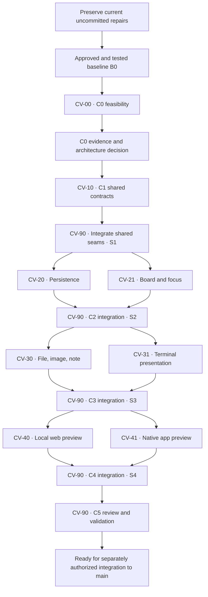

# Execution and Worktree Plan

<Callout type="decision">
2026-10-17 execution override: the user authorized local commits and implementation with one agent, sequentially, without implementation subagents. Follow C0–C5 and the path boundaries below in the primary checkout. The branch/worktree fan-out is superseded. No application pushes or releases are authorized. Baseline commit: `0c4db05`. Consult Astra at Medium only if genuinely needed.
</Callout>

Proposed execution for Rafu Canvas, based on the inspected working tree on 2026-10-17. This page plans C0–C5. It does not authorize application commits, implementation worktrees, Canvas code, merges, or application pushes.

<Callout type="decision">
Use nine logical worktrees over several waves, including the integration worktree. Run at most two implementation workers at once, plus the coordinator and an independent reviewer. Run one expensive build, test, or profile operation at a time on this Mac. These are proposed assignments; no worktree has been created for this plan.
</Callout>

[Visual plan](https://rafu-canvas-plan.saglanivatsal.chatgpt.site/) · [Clickable wireframe](https://rafu-canvas-plan.saglanivatsal.chatgpt.site/prototype)

## 1. Repository evidence and scope

| Inspected item | Current behavior | Consequence for Canvas |
|---|---|---|
| `Editor/EditorLayout.swift` | `EditorTabResource` has file, legacy terminal, Terminal Group, and generic restorable cases. Terminal Group restore checks a matching inert record. | Add a typed Canvas resource and matching restore classification. Do not use the generic restorable case as an untyped shortcut. |
| `Models/WorkspaceAuxiliaryTabs.swift` | Settings and Ensemble tabs are window-only and excluded from the restorable layout. | Preserve them. A saved Canvas needs a separate persisted resource. |
| `Views/EditorCanvasView.swift` | Retains the existing editor layout while auxiliary content is selected. | Keep the retained file editor, dirty text, and undo state when Canvas gets focus. |
| `Models/WorkspaceSession.swift` | Owns window selection, terminal actions, close rules, and restoration coordination. | One integration owner changes this file. Card adapters send typed requests. |
| `Terminal/TerminalGroupView.swift` | Receives snapshots and existing controllers, then sends typed view actions. | Reuse this boundary; do not create a second process manager. |
| `Terminal/EditorTerminalTabContent.swift` | `TerminalHostView` mounts the native terminal and guards delayed focus. | Test view transfer and stale focus before adding a Canvas lease. |
| `Services/WorkspaceRestorationStore.swift` | Encodes workspace metadata; terminal records decode separately and tolerate missing or malformed fields. | Add a versioned Canvas index. Keep note text in the separate atomic Canvas store. |
| `Package.swift` | Swift tools 6.2, macOS 15 minimum, GUI default MainActor isolation. | Probe supported APIs from macOS 15 onward. Keep shared values explicitly nonisolated and Sendable. |
| ADR 0023 and 0024 | Terminal Groups use explicit start and inert restore. Limits are 20 groups, 10 panes per group, 200 retained panes and 200 live sessions per window. | Use the existing independent limits. Canvas adds no second terminal allowance. |

Paths in this table are relative to `Sources/RafuApp`, except `Package.swift` and the ADRs. New Canvas paths below are proposed; they do not exist yet.

The inspected `main` HEAD is `84fd5f42524082dcded7a6d0c8c2697a279302d1`. This is an evidence reference, **not** the approved Canvas base. The working tree has tracked and untracked changes that are absent from that commit. Existing worktrees are also present. Do not reuse, reset, remove, or clean them without checking their owner and state.

### This is separate from the earlier eight-worktree repair

| Earlier performance/UI repair | New Canvas execution |
|---|---|
| Editor lifetime, viewport, gutter, syntax, Find, navigation/restoration, window appearance, test/build repair | Spatial board, resource cards, focus, safe persistence, local web previews, native window previews |
| Work within the existing workbench feature scope | New product scope that needs a proposed architecture decision |
| Results were integrated as uncommitted application changes | Must start from a later approved baseline that contains the selected repairs |
| Later follow-ups added file size handling, window drag, single-click opening, hover timing, auxiliary tabs, and modified Return handling | Must preserve these behaviors and their tests |
| Source: `docs/plans/phases/editor-performance-repair.md` | Source: `docs/plans/phases/workspace-canvas.md` and this execution plan |

Do not reopen the eight repair assignments as Canvas workers. Their performance claims and any pending interactive checks remain subject to their own evidence. A prior passing repair test run does not prove Canvas performance.

## 2. Gate B0: protect the current work before fan-out

<Phase title="Prepare an approved baseline" status="planned">
The coordinator prepares a reviewable baseline manifest. Worktree creation waits for a clean, fixed commit that the user has authorized.

<Checklist title="Baseline gate">
- [ ] Record branch, HEAD, tracked and untracked paths, and active worktree owners. Keep the primary checkout unchanged during the review.
- [ ] Classify current changes as required repairs, Canvas planning documents, unrelated work, or unresolved work. Review exact file contents; a path alone is not approval.
- [ ] Keep the existing uncommitted work and its recovery evidence. Do not reset, clean, stash, bulk-copy, or overwrite it to obtain a clean tree.
- [ ] Obtain explicit authority for the selected application baseline commit and later local branch integration. Planning-site publication grants neither.
- [ ] With that authority, run the baseline format, build, parallel, serial, and Lightning launch gates. Resolve or document known failures before accepting the baseline.
- [ ] Commit only the approved selection. Record its full SHA as B0, its file manifest, checks, and known limits. Verify the committed tree matches the tested tree.
- [ ] If unrelated changes remain in the primary checkout, leave them there. Create the isolated integration worktree from B0 only after worktree creation is authorized.
</Checklist>

<Callout type="warn">
If the user does not authorize a baseline commit, implementation fan-out remains blocked. Continue planning only. A patch copy, automatic stash, or a branch at the current HEAD is not a substitute for the tested baseline. No such operation is part of this update.
</Callout>

</Phase>

## 3. Worktree and branch assignments

All names below are reservations in the plan, not existing branches. Use managed worktree creation after authorization. Record the returned absolute path; do not assume a generated directory name. Each branch is prefixed with `codex/`.

| ID and phase | Logical worktree / branch | Start from | Owns | Exit evidence |
|---|---|---|---|---|
| CV-90 · C1–C5 | `canvas-90-integration` / `codex/canvas-90-integration` | B0 | Shared app integration, architecture decision, indexes, final checks | Reviewed integration commits S1–S4 and final C5 evidence |
| CV-00 · C0 | `canvas-00-feasibility` / `codex/canvas-00-feasibility` | B0 | `Prototypes/CanvasFeasibility/`, `docs/references/canvas-feasibility.md` | Terminal transfer, window capture, WebKit lifecycle results on supported OS versions |
| CV-10 · C1 | `canvas-10-contracts` / `codex/canvas-10-contracts` | Accepted C0 decision commit | `Sources/RafuApp/Canvas/Domain/`, `Canvas/Contracts/`, `Tests/RafuAppTests/Canvas/Contracts/` | Compiling value types, typed commands, resource contracts, schema and inert-state tests |
| CV-20 · C2 | `canvas-20-storage` / `codex/canvas-20-storage` | S1 | `Canvas/Persistence/`, `Tests/RafuAppTests/Canvas/Persistence/`, `docs/references/canvas-persistence.md` | Atomic save, conflict detection, corruption limits, recovery, cancellation tests |
| CV-21 · C2 | `canvas-21-surface` / `codex/canvas-21-surface` | S1 | `Canvas/Presentation/`, `Tests/RafuAppTests/Canvas/Presentation/`, `docs/references/canvas-input-and-layout.md` | Board/list navigation, selection, move/resize, undo, focus, two-window UI evidence |
| CV-30 · C3 | `canvas-30-documents` / `codex/canvas-30-documents` | S2 | `Canvas/Cards/Files/`, `Canvas/Cards/Images/`, `Canvas/Cards/Notes/`, matching `Tests/RafuAppTests/Canvas/Cards/` subfolders, `docs/references/canvas-document-cards.md` | File/undo reuse, bounded previews, native note editing and recoverable save |
| CV-31 · C3 | `canvas-31-terminals` / `codex/canvas-31-terminals` | S2 | `Canvas/Cards/Terminal/`, the three terminal view files listed below, `Tests/RafuAppTests/Canvas/Terminal/`, `docs/references/canvas-terminal-lease.md` | One controller and PTY, one visible view owner, safe transfer, close and focus tests |
| CV-40 · C4 | `canvas-40-web` / `codex/canvas-40-web` | S3 | `Canvas/Cards/Web/`, `Tests/RafuAppTests/Canvas/Web/`, `docs/references/canvas-web-preview.md` | Loopback URL policy, redirect handling, explicit connect, unload, resource bounds |
| CV-41 · C4 | `canvas-41-native-apps` / `codex/canvas-41-native-apps` | S3 | `Canvas/Cards/NativeApp/`, `Tests/RafuAppTests/Canvas/NativeApp/`, `docs/references/canvas-native-app-preview.md` | Picker cancel/deny/revoke, source loss, stop, app activation, capture bounds |

`Canvas/...` means a path below `Sources/RafuApp/Canvas/`. Each worker owns only its named paths. The independent reviewer owns no implementation paths and reviews the candidate tree without concurrent edits.

### CV-90: exclusive shared-file ownership

Only the coordinator edits these shared integration paths. Workers submit a small requested change with a test case; they do not edit these files in parallel.

<FileTree>
- modify Sources/RafuApp/Editor/EditorLayout.swift -- typed Canvas resource and classification
- modify Sources/RafuApp/Editor/EditorTabSwitcher.swift -- one entry per Canvas
- modify Sources/RafuApp/Models/WorkspaceSession.swift -- window state and action routing
- modify Sources/RafuApp/Models/WorkspaceAuxiliaryTabs.swift -- preserve auxiliary tab behavior
- modify Sources/RafuApp/Views/EditorCanvasView.swift -- resource presentation and focus
- modify Sources/RafuApp/Views/WorkspaceWindowView.swift -- window composition
- modify Sources/RafuApp/Views/CommandPaletteView.swift -- visible command discovery
- modify Sources/RafuApp/Views/EditorTabSwitcherView.swift -- Canvas switcher presentation
- modify Sources/RafuApp/App/RafuAppCommands.swift -- menus and keyboard routing
- modify Sources/RafuApp/App/RafuApp.swift -- scene and shutdown integration if required
- modify Sources/RafuApp/Services/WorkspaceRestorationStore.swift -- safe Canvas index
- modify Sources/RafuApp/Services/WorkspaceTerminationPersistence.swift -- flush and close ordering
- add Sources/RafuApp/Canvas/Integration/ -- session store and adapter assembly
- add Tests/RafuAppTests/Canvas/Integration/ -- cross-resource and two-window tests
</FileTree>

The coordinator also owns `Package.swift`, shared build scripts, `AGENTS.md`, ADRs, phase documents, and documentation indexes. Ownership permits a needed change; it is not a requirement to edit every listed file. No new dependency, entitlement, privacy permission, or deployment target change is pre-approved.

The terminal worker's existing-file grant is limited to:

- `Sources/RafuApp/Terminal/EditorTerminalTabContent.swift`
- `Sources/RafuApp/Terminal/TerminalGroupView.swift`
- `Sources/RafuApp/Terminal/TerminalGroupSplitView.swift`

The terminal controller, `TerminalsPanelModel`, runtime, restoration codec, launch service, `RafuTerminalView`, and modified-Return policy remain read-only to that worker. If a controller or command seam must change, the coordinator applies and tests that request. File-card workers likewise do not rewrite `EditorDocument`, `CodeEditorView`, file-service, or native Markdown ownership.

## 4. C0 and C1: freeze the contracts before parallel work

<Phase title="C0 · Native feasibility" status="planned">
CV-00 runs three bounded probes in one worktree. It does not change the product route or ship a hidden Canvas feature.

<Checklist title="Probe report gate">
- [ ] Record OS, toolchain, hardware, commands, observations, and unresolved limits.
- [ ] Separate measured results from design assumptions.
- [ ] Get review of all three probes before accepting the C0 decision.
</Checklist>

| Probe | Must prove | Failure path |
|---|---|---|
| Terminal view transfer | Detach/attach preserves controller identity, output draining, input, selection, focus, and PTY dimensions. Zoom does not send repeated resize events. | Revise presentation; do not create a duplicate session to make the picture work. |
| Native app preview | macOS 15+ picker, cancel/deny/revoke, minimized or closed source, display changes, lock, stop, activation, and resource release | Retain the app reference and Open App behavior; defer live capture if unsupported. |
| Local web preview | Nonpersistent data store, loopback destination checks, explicit input, hidden-surface teardown, and no native script bridge | Defer live web content until its lifetime and navigation policy are proved. |

Use a coordinator-controlled Rafu Lightning test bundle for GUI checks. Do not launch the release editor. The probe code stays isolated under its owned prototype directory. Merge the verified report, not experimental runtime code, unless a later review explicitly accepts a reusable piece.

</Phase>

<Phase title="C1 · Shared contracts and serial integration" status="planned">
The coordinator records the C0 decision in a proposed ADR. Acceptance must precede product changes. CV-10 then defines contracts; CV-90 applies the shared file integration and freezes S1.

<Checklist title="Contract freeze gate">
- [ ] Compile each adapter against the same contract fixtures.
- [ ] Test schema compatibility and default inert states before adding live resources.
- [ ] Record the exact contract and integration SHA for downstream workers.
</Checklist>

| Contract | Frozen before S1 | Owner / consumer |
|---|---|---|
| Document schema | `CanvasID`, card and connection IDs, safe resource references, geometry, ordering, schema version, bounds, viewport | CV-10; all workers |
| Persistence | Workspace key, load/save/delete, expected revision, atomic replacement, recoverable note snapshot, bounded diagnostics | CV-10 contract; CV-20 implementation |
| UI state | Per-window selection, board/content mode, viewport, focus requests, close and save intents; no live full text in observable state | CV-10 contract; CV-90 session owner; CV-21 view |
| Resource adapter | Typed identity, summary state, explicit enter/leave/start/stop requests, visibility events, cancellation generation | CV-10 contract; CV-30/31/40/41 adapters |
| Terminal lease | Group ID, current presentation owner, acquire/transfer/release, stale-release guard; no new process ownership | CV-10 contract; CV-31 implementation; CV-90 routing |
| Resource budget | Shared terminal limits, live surface limits, paused reason, explicit resume behavior | CV-10 values; adapters enforce; CV-90 coordinates |
| Restoration | Typed Canvas tab with a valid saved record; missing/corrupt record fallback; no commands, tokens, output, or captured frames | CV-10 codec contract; CV-20 and CV-90 |

The proposed ADR must narrowly cover spatial tabs, terminal presentation transfer, local-app WebKit, and selected-window capture. Keep native Markdown/Mermaid, external CLI execution rules, and Ensemble naming unchanged. Choose the next available ADR number when implementation begins; this plan does not reserve or accept one.

</Phase>

### Contract decisions that must close at S1

- Focus stays inside the Canvas tab; Back to Canvas restores viewport and selection.
- New Canvas naming, cancellation, menu location, and keyboard shortcut are explicit.
- Save flushes the current note edit before the Canvas snapshot. Define Save routing in terminal and web content.
- A group referenced by several boards still has one visible owner. A competing surface shows Reveal or Transfer; it cannot mirror the same native view.
- Define offscreen, overview, hidden-tab, locked-window, and closed-window transitions separately. Hidden capture stops; any resumed live work needs the agreed explicit action.
- Define note close prompts, crash recovery, two-window document sharing, and expected-version conflicts. Do not let two windows silently overwrite one board.
- Undo restores references and geometry. It cannot restart a closed process, reconnect a web view, or restart capture.
- Define capacity failure UI and keyboard/VoiceOver alternatives for move, resize, arrange, and connection edits.

These are required contract choices, not a request to add all details during this planning-site update. If C0 changes a choice, update the phase plan and ADR before freezing S1.

## 5. Parallel waves and integration order

| Order | Workers allowed together | Coordinator action | Fixed output |
|---|---|---|---|
| 0 | None | Preserve changes; obtain authority; accept B0 | B0 SHA and baseline manifest |
| 1 | CV-00 only | Review evidence; accept the architecture decision; no product rollout | Decision SHA |
| 2 | CV-10 only | Integrate contracts, typed tab/restoration seams, and inert adapter fixtures | S1 SHA |
| 3 | CV-20 + CV-21 | Merge storage first, then surface; wire store to the board; run C2 gate | S2 SHA |
| 4 | CV-30 + CV-31 | Merge document cards first, then terminal lease; wire real adapters; run C3 gate | S3 SHA |
| 5 | CV-40 + CV-41 | Merge web preview first, then native preview; verify combined limits; run C4 gate | S4 SHA |
| 6 | CV-90 + read-only reviewer | Run C5, resolve findings, and prepare the final integration report | Final candidate SHA |
| 7 | No worker edits | Integrate to `main` only after separate authority; run coordinator gates again | Recorded main SHA |

All S1–S4 names are future gate labels, not branch names or fabricated SHAs. Record a full commit SHA after each accepted gate. Start every new worker from its listed fixed SHA, not from a moving `main` or integration branch. The current dirty checkout is never used as an implicit base.

Workers in a wave use frozen fixtures and protocols so they can compile independently. They may read other modules, but they cannot alter another owner's paths. If a shared contract changes, stop the affected workers, let its owner land the change, record a new base, and restart from that base. Do not make competing copies of a protocol.

Each completed worker hands off one reviewed commit sequence. The coordinator integrates that sequence in the listed order. Do not both merge and cherry-pick the same work. Resolve conflicts with the path owner; do not use blanket ours/theirs resolution. A failed wave does not advance its S-label or release the next wave.

## 6. Review and validation gates

<Phase title="Each worker: prove the owned behavior" status="planned">
Get a coordinator build slot. Run focused tests while iterating. An independent reviewer checks the exact final candidate.

<Checklist title="Worker handoff">
- [ ] Record changed paths, parent SHA, final SHA when commits are authorized, commands, results, and known limits.
- [ ] Run `./script/format.sh --fix`, then `./script/format.sh --lint`, then `./script/build.sh`, then `./script/test.sh` in that order.
- [ ] Make no file edit after the final parallel test. If a file changes, repeat the affected checks and final parallel run.
- [ ] Reviewer runs `./script/test.sh --no-parallel`; also run parallel when the change affects concurrency.
- [ ] Use the project-local Swift concurrency review for tasks, actors, cancellation, capture, process I/O, and cross-actor state.
- [ ] GUI changes pass `./script/build_and_run.sh --verify` and a usability pass with a second window and keyboard input.
- [ ] Record new platform or lifecycle findings in the worker's reference note. Coordinator updates shared indexes.
</Checklist>

</Phase>

| Gate | Specific required checks |
|---|---|
| C1 / S1 | Schema bounds, unknown versions, stable IDs, missing records, window isolation, and zero-work restoration using fakes |
| C2 / S2 | Pan/zoom, move/resize, selection, connections, undo, save conflict, recovery, Canvas List, keyboard and VoiceOver |
| C3 / S3 | Dirty file and undo survive; notes flush atomically; one terminal view and PTY; hidden terminal still drains output; modified Return, pane focus, park/close, and Agent/Ensemble limits stay correct |
| C4 / S4 | Loopback redirects, URL sanitization, permission cancel/deny/revoke, source loss, lock, stop, capacity, no capture fallback to a full display, and no automatic app start on restore |
| C5 | Both full test modes, canonical Lightning launch, two windows, file/Settings/Ensemble/Canvas switching, safe close/reopen, accessibility settings, security review, and measured resource use |

### Build and test coordination

Use `./script/build.sh` and `./script/test.sh`; they check the build lock. If running SwiftPM directly, first use `./script/await_build_lock.sh`. A present lock is not proof of a live holder. Never delete a held lock or run a second build while the first owns it. Do not write shell polling loops.

Allocate one expensive machine operation at a time even across separate worktrees. Keep other workers on source review or independent edits. Use local worktree caches; do not point parallel checkouts at one shared `.build`. Check free disk space before opening a new wave. Remove an implementation worktree's `.build` only after its checks pass and its authorized commits are complete. Keep the primary checkout cache. Do not remove unrelated worktrees or failed caches to hide a failing result.

If the formatter changes a path outside the worker's ownership, report it to the coordinator. Do not include that change silently in the handoff. The coordinator resolves the path ownership before the final checks.

For a failing test, run that exact test alone and compare parallel and serial results. A parallel failure that passes alone and serially can be scheduler load; do not weaken the test. A serial-only failure can be order dependence. A test outside the worker's ownership is a stop-and-report to the coordinator. Limit reviewer/worker correction to two rounds, then escalate with evidence.

### Security and performance evidence

| Area | Required evidence; no claim before measurement |
|---|---|
| Terminal | Process and controller identity across transfers; explicit starts; no new command injection; existing 20/10/200/200 limits preserved |
| Web | Validated loopback origin and redirects; nonpersistent store; no native bridge, file access, credential injection, or certificate bypass |
| Native app | User-selected capture only; no recording, OCR, external transmission, synthetic input, or automatic permission request |
| Files and notes | Workspace-safe references, bounded decode, atomic writes, expected revisions, dirty-buffer precedence, cancellation |
| Restore | No shells, agents, servers, browser loads, apps, or captures start; no output, token, cookie, PID, or frame persistence |
| Memory and latency | Idle before/after; separate WebKit process memory; 100-card pan/zoom; four visible terminal surfaces; repeated attach/detach; p95 typing and frame measurements |

The existing idle-local target is roughly 150 MB. The active Canvas budget is not measured yet. C0 must propose it from evidence. The phase suggests two web controllers, two capture streams, and bounded 10 fps capture; these are design ceilings, not verified results. The current local workflow permits Lightning builds only. Any non-launching Release measurement needs an explicit phase allowance before use; no release editor launch is authorized.

## 7. Integration, rollback, and handoff

- CV-90 keeps a gate ledger: base SHA, each worker candidate, integration SHA, checks, reviewer, and accepted limits. Each candidate must include the worker's final files and docs.
- Before each integration, confirm its base contains the frozen contracts. Preserve existing editor, terminal, Settings, and Ensemble tests; new Canvas tests do not replace them.
- A failing integration stays on the isolated integration branch. Repair it with the owner and rerun checks. Do not copy a partial feature into the dirty primary checkout.
- If rollback is needed after an authorized integration, prepare a focused revert of the Canvas commit sequence. Preserve unrelated work and any user notes. Never reset or clean the primary checkout.
- Finish C5 before proposing integration to main. The final report states delivered behavior, changed paths, security review, accessibility checks, performance evidence, unresolved items, and migration/restore behavior.
- Main integration and any push need separate authority. After an authorized merge, the coordinator runs both test modes and the canonical Lightning launch on the resulting main tree.
- Only then retire the completed Canvas worktrees under the repository's cleanup rules. Keep failed work and its evidence until its owner has resolved the failure.

## 8. Decisions needed to start implementation

<Questions title="Future start gate; not needed to read this plan">
- Which current application changes should be included in the approved baseline commit?
- After C0 evidence, does the proposed ADR accept native app previews plus Open App, local web previews, and terminal presentation transfer?
- Are implementation worktree creation, selected application commits, and local integration authorized? Application pushes remain a separate action.
</Questions>

<Callout type="note">
No decision is required to publish this planning update. The existing private site retains the original visual plan and wireframe. No implementation worktree, application commit, application merge, or application push was performed for this update. The hosting workflow commits only the separate planning-site source.
</Callout>

## Evidence references

- `docs/plans/phases/workspace-canvas.md`: product scope and C0–C5.
- `docs/plans/phases/pre-initial-push-workbench.md`: active workbench acceptance contract.
- `docs/plans/phases/editor-performance-repair.md`: the earlier eight-worktree repair and follow-up ownership.
- `docs/decisions/0023-terminal-groups-and-saved-layouts.md` and `0024-terminal-group-v2-limits-and-pane-metadata.md`: accepted terminal boundaries.
- `AGENTS.md`, `docs/references/skill-routing.md`, and `docs/references/build-and-run.md`: skill, build, launch, review, and cleanup rules.
- Repository inspection: `git status --short --branch`, `git rev-parse HEAD`, `git worktree list --porcelain`, and the source paths named above. These describe the working tree, including uncommitted repairs.
