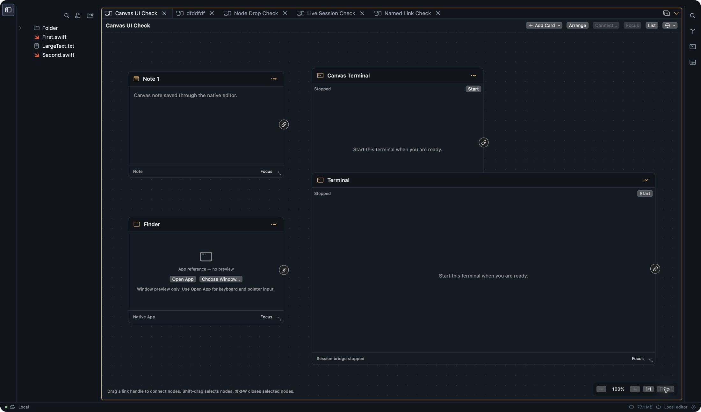
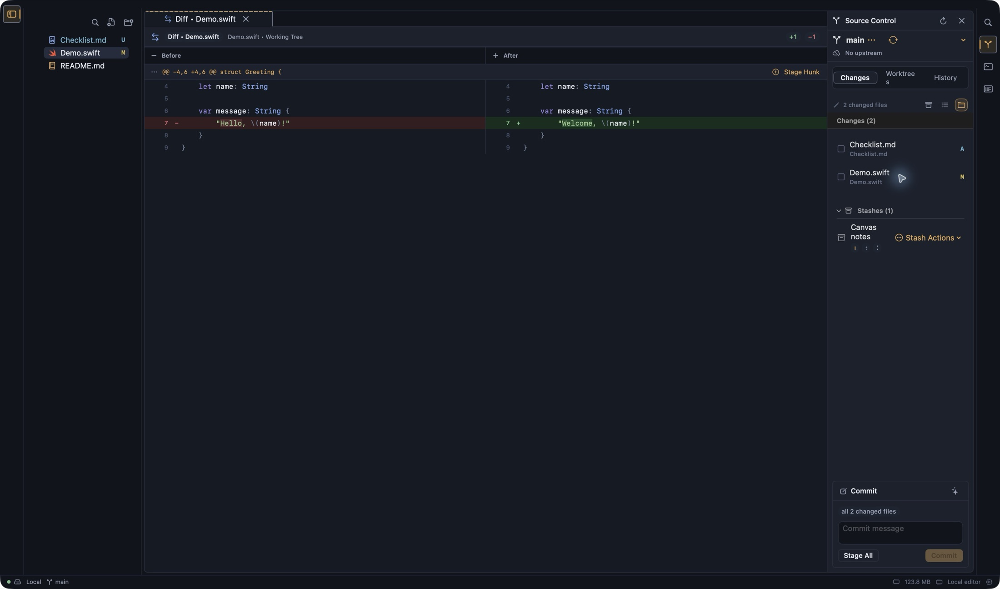
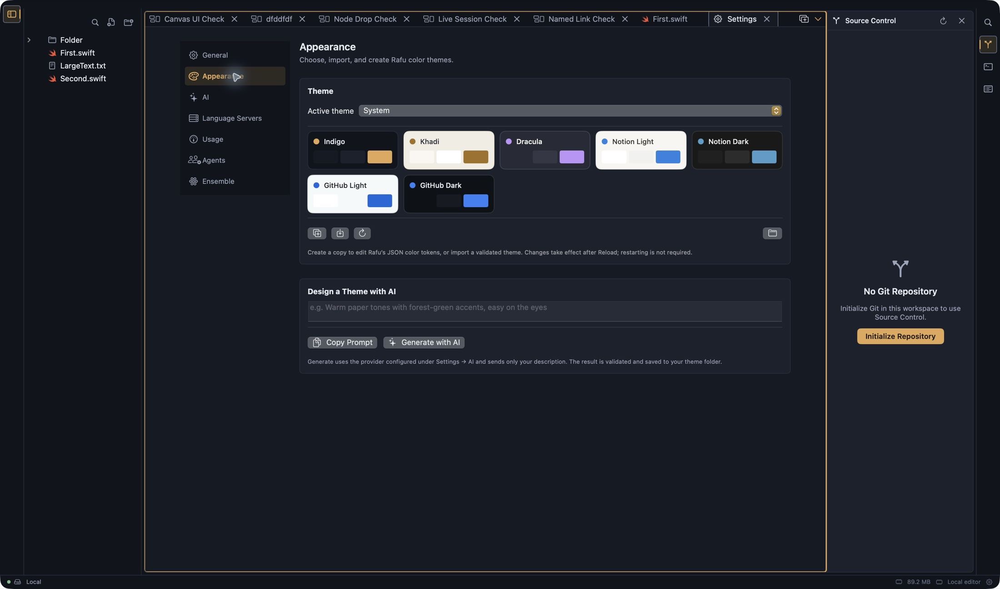
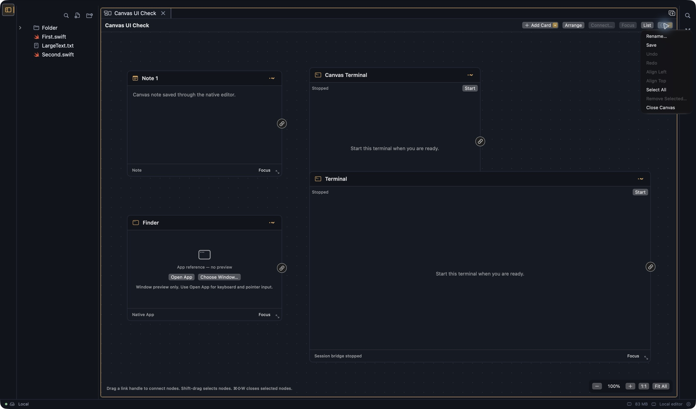

# Rafu screen catalog

Captured on 18 October 2026 from **Rafu Lightning**. These images show the local development build. They use disposable local workspaces. The Git workspace has no remote.

All 44 files are JPEG images. Main window images are 2200 × 1297 pixels. Small sheets keep their aspect ratio. Images use JPEG quality 84. The capture source is the app window from CUA. No generated product image is included.

## Main screens

| Image | Screen and controls |
|---|---|
| [Canvas board](01-canvas-overview.jpg) | Add Card adds content. Arrange places cards. Connect links selected cards. Focus opens selected content. List changes the board to a list. Zoom out, Zoom in, 1:1, and Fit All control the view. |
| [Canvas list](canvas-list.jpg) | Lists cards and relationships. Select selects a card. Remove opens the removal step. Board returns to the board. |
| [Canvas picker](canvas-picker.jpg) | Opens a saved canvas. The trash button removes a saved canvas. Cancel closes the picker. |
| [Connect cards](canvas-connect.jpg) | From and To select cards. Label names the relationship. Save creates the link. Cancel closes the sheet. Terminal links permit messages between connected sessions. |
| [Source editor](editor.jpg) | File tree opens files. New File and New Folder create workspace items. The tab close button closes the document. The sidebar toggle shows or hides Files. |
| [Find and replace](find.jpg) | Find locates text. Previous and Next move between matches. Case, Whole Word, and Regular Expression change matching. Replace and Replace All change text. Close Find hides the bar. |
| [Workspace search](search.jpg) | Search locates text in the workspace. Results are grouped by file. Replace reveals replacement controls. File filters limit the search. Case, Whole Word, and Regular Expression change matching. |
| [Markdown split](markdown-split.jpg) | Edit shows source. Preview shows rendered Markdown. Split shows both. The file path buttons reveal folders in Files. |
| [Command palette](command-palette.jpg) | Searches commands and files. Prefixes select commands, file symbols, workspace symbols, or a line number. Select a result to execute its command or open its file. |
| [Resources](resources.jpg) | Shows shared app memory, terminal processes, loaded tabs, and language servers. The View buttons select resource detail views. |
| [Git changes](git-changes.jpg) | Refresh updates status. The branch button selects a branch. Stash Changes opens the stash step. Flat List and Grouped by Folder change the list. Generate Commit Message requests a draft. Stage All stages changes. Commit creates the requested commit. |
| [Git diff](git-diff.jpg) | Shows Before and After with changed lines. Stage Hunk stages one hunk. The tab close button closes the diff. |
| [Git history](git-history.jpg) | Searches loaded commits. Fetch requests a remote fetch. Select a commit to see its details. |
| [Commit details](git-commit-details.jpg) | Shows the commit identity and changed files. Select a file to open its diff. |
| [Git worktrees](git-worktrees.jpg) | Add Worktree opens worktree creation. Refresh updates the list. Each row has a worktree actions menu. |
| [Terminal manager](terminal-manager.jpg) | New Terminal adds a terminal. Choose Terminal Shell selects a shell. The agent buttons start a selected installed CLI only when selected. Disclosure buttons show panes. |
| [Terminal editor](terminal-editor.jpg) | Shows an inert, stopped pane. Start starts the pane. Rename changes its label. Close closes the pane. |
| [Ensemble runs](ensemble-runs.jpg) | New Ensemble opens coordinator setup. New Run opens role or workflow setup. Show Ensemble Graph opens the graph. Section buttons select Runs, Workflows, or Activity. |
| [New Ensemble](ensemble-new.jpg) | Name names the Ensemble. Describe a Goal, From a Template, and Existing Workflow select its source. Budget controls limit child runs. Start Coordinator starts the requested coordinator. |
| [New run](ensemble-new-run.jpg) | Mode selects role or workflow. Agent file selects a role. Provider and Model override its defaults for this run. Task prompt and Base reference define the task. Run starts the requested run. |
| [Workflow library](ensemble-workflows.jpg) | Lists repository workflows. New from Template creates a workflow from a template. Open opens its file. |
| [Ensemble activity](ensemble-activity.jpg) | Shows lifecycle events for the open workspace. This fixture has no run activity. |
| [Ensemble graph](ensemble-graph.jpg) | Shows the run graph. This fixture has no runs. |





## Settings

Viewing these screens did not change the settings or send a provider test request.

| Image | Controls |
|---|---|
| [General](settings-general.jpg) | Process memory display, terminal attention destination, and notch companion. |
| [Appearance](settings-appearance.jpg) | Active theme and theme choices; Create Copy, Import JSON, Reload, Reveal Theme Folder; AI description, Copy Prompt, and Generate with AI. |
| [AI](settings-ai.jpg) | Provider selection, Add Provider, Delete Provider; name, provider type, base URL, model ID, alias, API, and secure API key; Test Connection and Save. |
| [Language Servers](settings-language-servers.jpg) | Refresh, server installation, Packs, Add Custom Server, and workspace trust revocation. The lower content can scroll. |
| [Usage](settings-usage.jpg) | Provider order, provider enable controls, explicit connection controls, secure key fields, tests, and browser import controls. This image shows the top of the long provider list. |
| [Agents](settings-agents.jpg) | CLI enable controls, install and sign-in status, default model, custom model ID, and model refresh where supported. The lower content can scroll. |
| [Ensemble](settings-ensemble.jpg) | Install for Claude Code and Install to Folder install the Ensemble skill to the selected location. |



## Three-dot and overflow menus

Each link opens an image with the menu open. No destructive menu command was selected. A command can be disabled when its selection or state is not available.

| Menu image | Items and effect |
|---|---|
| [Canvas actions](menu-canvas.jpg) | Rename changes the canvas name. Save saves it. Undo and Redo change layout history. Align Left and Align Top align selected cards. Select All selects cards. Remove Selected opens removal. Close Canvas closes its tab. |
| [Note card](menu-canvas-note.jpg) | Focus opens the note. Rename changes its title. Connect to selects another card. Move Left/Right/Up/Down moves it by 20 points. Make Larger/Smaller changes its size by 40 points. Remove opens removal. |
| [File card](menu-canvas-file.jpg) | Uses the same common card actions. Focus shows file content in the canvas. Open File, on the card, opens the existing editor. |
| [Terminal card](menu-canvas-terminal.jpg) | Uses the common card actions and Copy Mention. Copy Mention copies the terminal's address for session messages. Start is on the card, outside this menu. |
| [Native app card](menu-canvas-native-app.jpg) | Uses the common card actions. Open App and Choose Window are on the card. The preview does not accept normal app input; Open App opens the app. |
| [Terminal group](menu-terminal-group.jpg) | Reveal opens the group. Rename changes its name. Save saves the inert layout. Start All Restartable Panes starts its restartable panes. Close Group closes the group. |
| [Terminal pane](menu-terminal-pane.jpg) | Reveal and Focus opens and selects the pane. Start Pane starts it. Rename changes its name. Color offers Accent, Blue, Green, Amber, Red, Gray, or No Color. Close Pane closes it. |
| [Git branch](menu-git-branch.jpg) | Merge into Current lists other branches. Create Branch opens branch creation. |
| [Git stash](menu-git-stash.jpg) | Apply Stash applies it and keeps it. Pop Stash applies it and then removes it. Drop Stash removes it. The latter two open a further step. |
| [Git worktree](menu-git-worktree.jpg) | Open in New Window opens the worktree. Copy Path copies its path. This main worktree does not offer removal. |
| [Workflow Actions](menu-ensemble-workflow.jpg) | Duplicate copies the workflow. Reveal in Finder shows its file. Open is a separate button beside the menu. |
| [Add Card](menu-canvas-add-card.jpg) | File, Image, Note, Terminal, Local Web App, and Native macOS App add the selected card type. File, Image, and app choices open selection dialogs. |
| [Git sync](menu-git-sync.jpg) | Fetch All requests a fetch. Pull offers Merge, Rebase, or Fast-Forward Only. Push requests a push. The fixture has no remote. |
| [Tab list](menu-tabs.jpg) | Lists open tabs. A check mark identifies the selected tab. Select an item to switch tabs. |



## Coverage and limits

- The common card menu is shared by file, image, note, terminal, web, and native app cards. Terminal adds Copy Mention. File, note, terminal, and native app examples were captured. Image and web variants were checked in `CanvasCardViews.swift`; they do not add menu items. They do not have separate menu images here.
- The older, single-terminal row menu is present in `WorkspaceTerminalsPanelView.swift`, but the fixtures use Terminal Groups. Its source-defined items are Rename, Reset to Automatic Name when a name exists, Color, Reveal, Hide Tab when available, and Close. There is no image for this legacy state.
- The worktree menu image uses the main worktree. A secondary worktree can also offer removal actions. No extra worktree was created for this catalog.
- No run was started for these images. Active-run output, review, approval, merge, failure, and completion states are not shown. New run, workflow, activity, and graph entry screens are included.
- Git history has one loaded commit. Its Load More control is not shown. That ellipsis is a button to load more commits, not an overflow menu. The ellipsis in the diff hunk header is a decorative image, not a menu.
- The macOS File menu was inspected. It contains New File, New Workspace Window, Open Folder, Save, Save Terminal Group As when applicable, and Go to File. CUA could not return an app screenshot while that native menu was active, so no menu image is included.
- These images show a dark system appearance. Light theme variants, remote workspaces, media previews, system permission prompts, and every possible error state are outside this capture set.
- Settings images show existing local connection status and installation paths. Secure key fields are empty or masked. No credentials or private project text are included.

The menu inventory was checked against `CanvasCardViews.swift`, `WorkspaceCanvasView.swift`, `GitInspectorView.swift`, `WorkspaceTerminalsPanelView.swift`, `ConductorRunsPanelView.swift`, `EditorCanvasView.swift`, and `GitCommitGraphView.swift`. The displayed menu items were also checked in the app accessibility tree.

## Capture verification

Use the following command to verify encoding and dimensions:

```sh
file docs/screenshots/*.jpg
sips -g format -g pixelWidth -g pixelHeight docs/screenshots/*.jpg
```

Only screenshot files and this index were added to the repository for the catalog. No source code changed. Build and test results are separate from this visual record.
